# 사용설명서

날짜별로 쌓아둔 소스 폴더 두 개를 골라 **무엇이 바뀌었는지** 확인하는 도구입니다.
운영과 테스트처럼 **환경이 다른 두 폴더**도 견줄 수 있습니다.
**내 PC 폴더**는 물론 **SSH 원격 서버**의 소스도 볼 수 있습니다.

## 화면 한눈에 보기

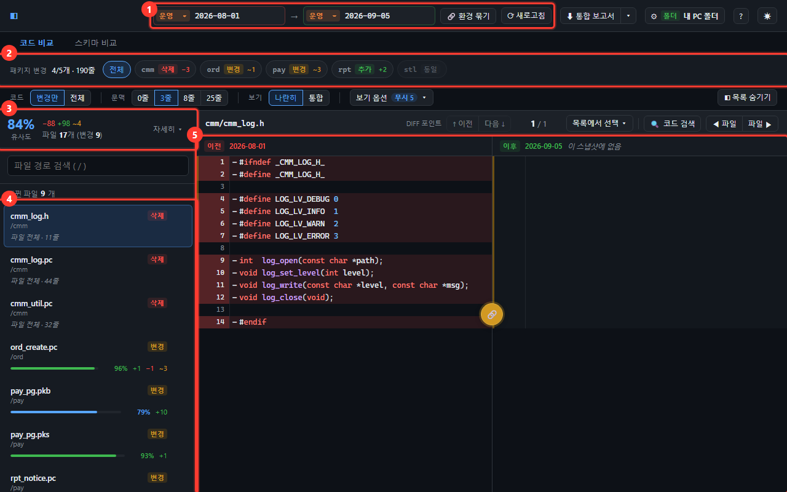

| | 이름 | 하는 일 |
| -- | ---- | ------- |
| ① | 비교할 곳 고르기 | 좌우 각각 **환경 + 날짜**를 고릅니다 → [2번](#2-비교할-날짜-고르기) |
| ② | 패키지 변경 | 어느 업무 폴더가 움직였는지 한 줄 요약 → [3번](#3-어느-업무가-바뀌었는지-먼저-보기) |
| ③ | 전체 유사도 | 두 폴더가 얼마나 닮았는지 한 줄로. **자세히 ▾** 를 누르면 지표가 더 나옵니다 |
| ④ | 파일 목록 | 바뀐 파일들. 누르면 오른쪽에 코드가 열립니다 → [4번](#4-바뀐-파일-고르기) |
| ⑤ | 코드 비교 | 왼쪽·오른쪽을 나란히 → [5번](#5-코드-비교-보기) |

화면 맨 위의 **코드 비교 / 스키마 비교** 탭으로 무엇을 견줄지 고릅니다.
**환경·날짜 고르는 자리는 둘이 똑같습니다** — 탭을 옮겨도 다시 고를 필요가 없습니다
→ [7번](#7-데이터-스키마-비교하기)

비교 결과를 공지에 붙이려면 맨 위의 **⬇ 보고서** 로 md 파일을 받습니다 (통합 · 소스 · 스키마) → [8번](#8-보고서-내려받기)

**쓰는 순서는 왼쪽 위에서 오른쪽 아래로 흐릅니다.**

> ① 비교할 두 곳 고르기 ➡️ ② 바뀐 업무 확인 ➡️ ④ 파일 고르기 ➡️ ⑤ 코드 보기

막히면 오른쪽 위 **?** 버튼(또는 `?` 키)을 누르세요. 화면 흐름 · 표시 읽는 법 · 단축키가 한 창에 나옵니다 → [9번](#9-단축키)

---

## 1. 준비하기

### 1-1. 비교할 폴더 알려주기

프로그램은 여러분이 지정한 폴더 하나를 바라봅니다.
그 폴더 안에는 **날짜별 폴더**가 들어 있어야 합니다.

```
D:\release\              ← 이 경로를 알려줍니다
├─ 2026-06-01\
│  ├─ ord\               ← 업무 단위 폴더 (= 패키지)
│  │  ├─ ord_create.pc
│  │  └─ ord_cancel.pc
│  └─ pay\
├─ 2026-07-01\
├─ 2026-08-01\
└─ 2026-09-01\
```

프로젝트 폴더의 **`change/config.ts`** 를 메모장으로 열어 폴더 경로를 바꿉니다.

> 처음 받았다면 이 파일이 아직 없을 수 있습니다.
> `npm install` 이나 `npm run dev` 를 한 번 실행하면 자동으로 만들어집니다
> (`change/config.example.ts` 를 복사해서). 이미 있으면 덮어쓰지 않습니다.

**처음 열면 SSH 원격이 선택된 상태입니다.** 서버 정보를 아직 안 넣었다면
"원격 서버에 접속하지 못했습니다" 가 뜹니다. 정상입니다.

#### 화면에서 바꾸기 — 가장 빠른 길

오른쪽 위의 **⚙ 버튼**에는 지금 읽고 있는 곳이 적혀 있습니다 (예: `⚙ 폴더 내 PC 폴더 sample-code`).
마우스를 올리면 전체 경로가 나오고, 누르면 **설정** 창이 열립니다.

> 오른쪽 위 **⚙ 버튼** 클릭 ➡️ ① 목록에서 **내 PC 폴더** 클릭 ➡️ ② **폴더 경로** 확인 ➡️ ④ **적용** 클릭

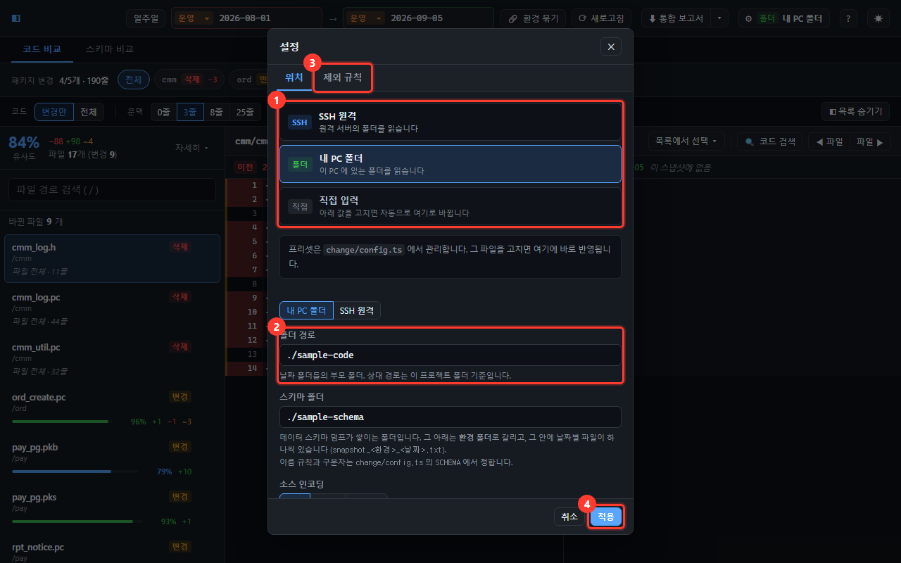

| | 자리 | 하는 일 |
| -- | ---- | ------- |
| ① | 프리셋 목록 | 미리 적어 둔 위치 중 하나를 고릅니다 |
| ② | 폴더 경로 | 날짜 폴더들의 **부모** 폴더입니다. 여기를 고치면 ①이 자동으로 `직접 입력` 으로 바뀝니다 |
| ③ | 제외 규칙 탭 | 늘 안 봐도 되는 파일을 접어 두는 규칙을 적습니다 ([4-1](#4-1-늘-안-봐도-되는-파일-접어-두기), [4-2](#4-2-이-파일만-잠깐-안-보고-싶습니다)) |
| ④ | 적용 | 누르면 바로 반영됩니다. **다시 시작하지 않아도 됩니다** |

- 설정 창의 칸은 **모두 적용을 눌러야** 반영됩니다. 적용하지 않은 변경이 있으면 아래에 표시되고,
  그대로 닫으려 하면 버릴지 한 번 묻습니다.
- 고른 값은 이 브라우저에 저장돼 다음에 열 때도 그대로입니다.
- 목록을 읽는 동안은 화면 가운데와 날짜 칸에 **읽는 중…** 이 표시됩니다. SSH 는 화면 가운데에 **SSH 연결 중…** 이 뜨고, 몇 초 걸릴 수 있습니다.

- 예시 폴더로 먼저 둘러보려면 → **⚙ 설정** 에서 `내 PC 폴더` 를 고르세요 (선택은 저장됩니다)
- 처음부터 폴더로 열리게 하려면 → `change/config.ts` 의 `DEFAULT_PRESET_ID` 를 `'local'` 로 바꾸세요

```ts
{
  id: 'local',
  label: '내 PC 폴더',
  source: { mode: 'local', root: 'D:/release', encoding: 'auto' },
},
```

> 경로 구분자는 `/` 또는 `\\` 를 씁니다. `\` 하나만 쓰면 인식되지 않습니다.
> 저장하면 **화면에 바로 반영됩니다.** 다시 시작하지 않아도 됩니다.

### 날짜 폴더 이름은 어떻게 지어도 되나요?

**됩니다.** 폴더명 어디에 날짜가 있든 찾아냅니다.

| 이렇게 지어도 | |
| ------------ | -- |
| `20260801` | 구분자 없이 |
| `2026-08-01` `2026.08.01` `2026_08_01` | 구분자 있게 |
| `rel_20260801` `20260801_v2` `20260801-hotfix` | 앞뒤에 글자가 붙어도 |
| `v2_20260801` `build-3-2026-08-01` | 앞에 다른 숫자가 붙어도 |

날짜가 최신인 폴더가 목록 위로 올라옵니다.

`trunk` 처럼 날짜가 없는 폴더도 **목록에 나오고 비교도 됩니다.** 다만 날짜 폴더들 뒤에 놓이고,
선택 목록에 `· 날짜 아님` 이라고 표시됩니다.

폴더명은 실제 폴더 이름 그대로 보여주므로, 화면에서 고른 이름이 곧 디스크의 폴더입니다.

### 1-1-2. 원격 서버(SSH)의 소스를 볼 때

`change/config.ts` 의 **SSH 프리셋**에 서버 정보를 넣고, 화면 오른쪽 위 **⚙ 설정** 에서
**SSH 원격** 을 고르면 됩니다.

```ts
{
  id: 'ssh',
  label: 'SSH 원격',
  source: {
    mode: 'ssh',
    host: 'dev-server',              // ← 서버 주소
    user: 'deploy',                  // ← 계정
    root: '/home/deploy/release',    // ← 날짜 폴더들의 부모 경로
    port: null,                      // 비우면 22
    identityFile: '',                // 비우면 기본 키
    encoding: 'auto',
  },
},
```

화면에서 값을 직접 고쳐도 됩니다. 그러면 **직접 입력** 으로 바뀌고 이 브라우저에만 저장됩니다.

| 넣을 값 | 설명 |
| ------- | ---- |
| **호스트** | 서버 주소. 예: `build-01` 또는 `10.0.0.5` |
| **포트** | 비워 두면 22 |
| **계정** | 서버 사용자명 |
| **개인키 파일** | 비워 두면 평소 쓰는 기본 키를 씁니다 (아래 1-1-3 참고) |
| **원격 경로** | 날짜 폴더들의 부모 경로. 예: `/home/deploy/release`, `~/release` |

**소스 인코딩** 은 로컬·SSH 어느 쪽이든 함께 적용됩니다.

| 고르면 | 동작 |
| ------ | ---- |
| **자동** (처음 값) | UTF-8 로 읽어보고 깨지면 EUC-KR 로 봅니다. 대부분 이대로 두면 됩니다 |
| **UTF-8** | 항상 UTF-8 로 읽습니다 |
| **EUC-KR** | 항상 EUC-KR 로 읽습니다 |

> UNIX 에서 오래 관리된 Pro\*C 소스는 대개 **EUC-KR** 입니다.
> 자동으로 두면 알아서 맞추고, 그래도 깨지면 EUC-KR 로 고정하세요.

**처음 접속하는 서버라면** 터미널에서 한 번 `ssh 계정@서버` 로 접속해 두세요.
"이 서버를 신뢰하겠느냐"는 질문에 `yes` 를 답해 두어야 이 도구에서도 접속됩니다.

### 1-1-3. 접속이 되려면

**비밀번호를 넣는 칸이 화면에는 없습니다.** 접속은 여러분 PC 의 `ssh` 가 평소 하던 대로 합니다 —
개인키 · ssh-agent · `~/.ssh/config`.

키로 붙지 않는 서버라면 **ssh 가 비밀번호를 물어봅니다.** 단, 묻는 자리가 화면이 아닙니다.

> **`npm run dev` 를 띄운 터미널 창**에 이렇게 뜹니다.
>
> ```
> deploy@build-01's password:
> ```
>
> 거기에 입력하면 접속됩니다. 화면은 그동안 기다립니다.

#### 주의 — 명령마다 물어봅니다

접속을 재사용하지 않아서, 원격 명령 하나마다 새로 물어봅니다.
다만 **명령을 몰아서 보내므로** 횟수는 많지 않습니다.

| 할 때 | 물어보는 횟수 |
| ----- | ------------- |
| 날짜 목록 불러오기 | **2번** (날짜 폴더가 몇 개든) |
| 좌우 비교 한 번 | 파일 200개당 **2번** (파일 500개면 7번) |
| 파일 하나 열기 | 2번 |

**30초 안에 입력하지 않으면** 그 명령은 실패합니다 ("30초 안에 끝나지 않았습니다").
IDE 안이나 백그라운드로 개발 서버를 띄워 **터미널 창이 안 보이면** 입력할 자리가 없어
이 오류로만 떨어집니다.

#### 한 번만 겪고 끝내려면 — 공개키 등록

```bash
ssh-keygen -t ed25519          # 키가 없을 때만
ssh-copy-id 계정@서버           # 이때만 비밀번호를 물어봅니다
```

그다음부터는 아무것도 묻지 않습니다. **비밀번호를 매번 치기 싫다면 이걸 권합니다.**

> **Windows 에 `ssh-copy-id` 가 없다면**
> `type $env:USERPROFILE\.ssh\id_ed25519.pub | ssh 계정@서버 "cat >> ~/.ssh/authorized_keys"`
> 로 대신할 수 있습니다.

| 이럴 땐 | 이렇게 |
| ------- | ------ |
| 개인키에 암호를 걸어 둠 | `ssh-add` 로 ssh-agent 에 한 번 올려 두세요 |
| 처음 접속하는 서버 | 터미널에서 한 번 `ssh` 로 접속해 `yes` 를 답해 두세요 |
| 키가 여러 개 | `~/.ssh/config` 에 적어 두거나, **개인키 파일** 칸에 경로를 넣으세요 |

### 프리셋이란

**⚙ 설정** 을 열면 위치 탭 위쪽에 고를 수 있는 목록이 나옵니다.

```
[SSH ]  SSH 원격        원격 서버의 폴더를 읽습니다              ← 처음 값
[폴더]  내 PC 폴더      이 PC 에 있는 폴더를 읽습니다
[직접]  직접 입력       아래 값을 고치면 자동으로 여기로 바뀝니다
```

| 상태 | 뜻 |
| ---- | -- |
| 프리셋을 고름 | `change/config.ts` 의 값을 씁니다. **그 파일을 고치면 바로 반영됩니다** |
| 직접 입력 | 화면에서 값을 고치면 자동으로 바뀝니다. 이 브라우저에만 저장됩니다 |

자주 쓰는 위치가 더 있으면 `change/config.ts` 의 목록에 항목을 더 붙이면 됩니다.

처음 열었을 때 어느 것이 선택될지는 같은 파일의 `DEFAULT_PRESET_ID` 로 정합니다.

```ts
export const DEFAULT_PRESET_ID = 'ssh'   // 'local' 로 바꾸면 폴더가 기본
```

> `change/config.ts` 는 **저장소에 올라가지 않습니다.**
> 서버 주소·계정을 적어 두어도 다른 사람에게 공유되지 않습니다.

### 1-1-4. 운영·테스트가 폴더로 나뉘어 있을 때

날짜 폴더가 환경별 폴더 **아래**에 쌓이는 경우가 있습니다.

```
/home/deploy/release/        ← 위 프리셋에 적는 경로
├─ prod/  20260801/  20260901/     ← 운영
└─ test/  20260801/  20260815/     ← 테스트
```

이럴 때는 날짜 칸 **왼쪽의 작은 선택** 에서 환경을 고릅니다.
고른 환경의 폴더가 위 경로 **뒤에 붙어**, 그 아래 날짜만 그 칸에 나옵니다.

**좌우가 각각 고릅니다.** 그래서 아래 세 가지가 모두 됩니다.

```
[운영 ▾ 20260801] → [운영 ▾ 20260901]      운영의 두 날짜 (예전과 같은 사용법)
[운영 ▾ 20260901] → [테스트 ▾ 20260815]    운영과 테스트가 지금 얼마나 벌어졌나
[운영 ▾ 20260801] → [테스트 ▾ 20260801]    같은 날짜가 두 환경에 똑같이 올라갔나
```

아래는 **운영과 테스트를 나란히 견주는** 화면입니다.

> 처음 열면 이 상태입니다 — 왼쪽 **운영**, 오른쪽 **테스트**.
> 다른 조합을 보려면 칸 앞의 환경만 바꾸면 됩니다.

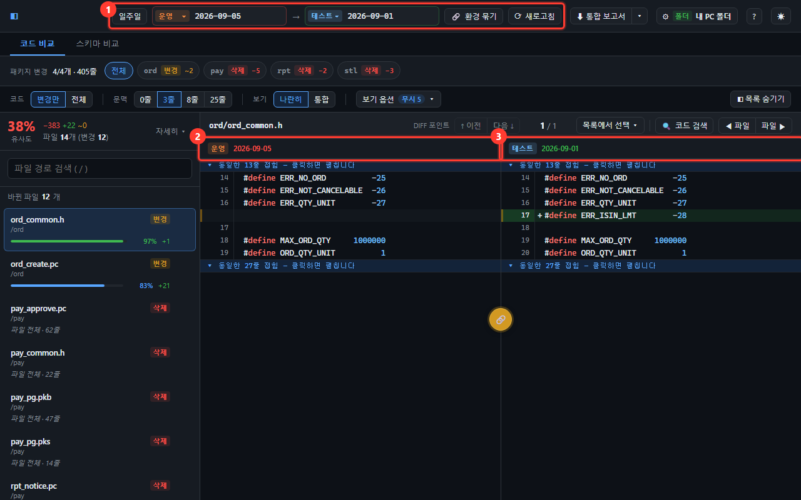

| | 자리 | 보이는 것 |
| -- | ---- | --------- |
| ① | 비교할 곳 | 왼쪽 **운영**(주황), 오른쪽 **테스트**(하늘색) |
| ② | 왼쪽 코드 머리 | `이전` 대신 **운영** 이라고 나옵니다 |
| ③ | 오른쪽 코드 머리 | `이후` 대신 **테스트** 라고 나옵니다 |

환경이 갈리면 `이전`/`이후` 라는 말을 쓰지 않습니다. 왼쪽이 더 최신일 수도 있어서
그렇게 부르면 사실과 달라지기 때문입니다.

- 날짜를 **같은 날로 맞출 필요가 없습니다.** 환경마다 배포하는 날이 달라서, 같은 날짜
  폴더가 양쪽에 다 있지 않은 것이 오히려 보통입니다.
- 양쪽 환경이 **다르면** 왼쪽이 오른쪽보다 최신이어도 됩니다 (테스트가 뒤처진 상태를
  보는, 정상적인 비교입니다). 양쪽이 **같은 환경**이면 예전처럼 오른쪽이 항상 더 최신입니다.
- 환경이 갈리면 칸 앞 표시와 diff 창 머리가 `이전`/`이후` 대신 **환경 이름**으로 바뀝니다.
- **환경마다 색이 다릅니다.** 운영은 주황, 테스트는 하늘색입니다. 어느 쪽을 보고 있는지
  이름을 읽기 전에 색으로 먼저 알 수 있습니다. (색은 `ENV_FOLDERS` 에 적은 순서대로 붙습니다)
- **처음 열면 왼쪽이 운영, 오른쪽이 테스트입니다.** 이 도구를 여는 이유가 대개
  "지금 운영과 테스트가 얼마나 벌어져 있나" 라서, 그 비교가 바로 뜨도록 해 뒀습니다.
  한 환경의 두 날짜를 보려면 오른쪽 환경을 왼쪽과 같게 고르면 됩니다.
  두 환경을 오가며 같은 비교를 반복한다면 **🔗 환경 묶기** 를 켜 두세요 ([2번](#환경을-양쪽-한꺼번에-바꾸기)).
- 고른 값은 이 브라우저에 좌우 한 쌍으로 저장돼, 다음에 열 때도 그대로입니다.
  예전에 쓰던 분은 양쪽 다 그때 고른 환경으로 열립니다.
- 목록·이름 순서는 `change/config.ts` 의 `ENV_FOLDERS` 에서 정합니다.

```ts
export const ENV_FOLDERS: EnvFolder[] = [
  { id: 'prod', label: '운영',   path: 'prod' },
  { id: 'test', label: '테스트', path: 'test' },
]

/** 처음 열었을 때 양쪽이 고를 값 */
export const DEFAULT_ENV_ID = 'prod'
```

`path` 는 여러 단도 됩니다 (`'rel/qa'` → `…/release/rel/qa`). 고치면 **바로 반영**됩니다.

날짜 폴더가 위 경로 **바로 아래**에 있으면(`release/20260801`) 배열을 **비워 두세요.**
고르는 자리가 화면에서 사라지고 그 경로를 그대로 읽습니다.

> 함께 들어있는 예시 폴더도 같은 배치입니다 (`sample-code/prod` · `sample-code/test`).
> **⚙ 설정** 에서 `내 PC 폴더` 를 고르면 아무것도 안 고치고 **운영 ↔ 테스트** 를 눌러 볼 수 있습니다.

> 환경마다 **서버·계정까지 다르면** 이 기능이 아니라
> 위 프리셋에 환경별 항목을 하나씩 두는 편이 낫습니다.

### 1-2. 실행하기

명령 프롬프트에서 프로젝트 폴더로 이동한 뒤 실행합니다.

```bash
npm run dev
```

화면에 나온 주소(기본 `http://localhost:5181`)를 브라우저에서 엽니다.

> 처음에는 **SSH 원격**이 선택돼 있습니다. 서버 정보를 아직 안 넣었다면
> **⚙ 설정** 에서 `내 PC 폴더` 를 고르면 함께 들어있는 예시 폴더로 바로 둘러볼 수 있습니다.
> 먼저 예시로 사용법을 익힌 뒤 실제 서버로 바꿔도 됩니다.

---

## 2. 비교할 날짜 고르기

화면 맨 위에서 비교할 두 곳을 고릅니다. **왼쪽 → 오른쪽** 방향으로 견줍니다.

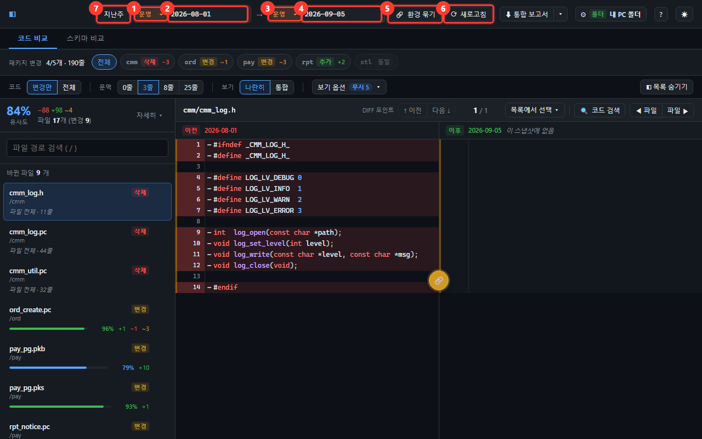

| | 자리 | 하는 일 |
| -- | ---- | ------- |
| ① | 왼쪽 환경 | 기준이 되는 쪽의 환경 (운영·테스트) |
| ② | 왼쪽 날짜 | 기준이 되는 날짜 폴더 |
| ③ | 오른쪽 환경 | 견줄 쪽의 환경 |
| ④ | 오른쪽 날짜 | 견줄 날짜 폴더 |
| ⑤ | 🔗 환경 묶기 | 켜 두면 환경을 **양쪽 한꺼번에** 바꿉니다 ([아래](#환경을-양쪽-한꺼번에-바꾸기)) |
| ⑥ | ⟳ 새로고침 | 폴더에 새 날짜가 생겼을 때 다시 읽습니다 |
| ⑦ | 지난주 | **지지난주 금요일 → 지난주 금요일**을 한 번에 고릅니다 ([아래](#지난주-한-번에-고르기)) |

> ① 왼쪽 환경 고르기 ➡️ ② 왼쪽 날짜 고르기 ➡️ ③ 오른쪽 환경 고르기 ➡️ ④ 오른쪽 날짜 고르기

- 환경 폴더를 설정하지 않았으면 ①③⑤ 자리가 아예 없고 `이전`/`이후` 표시만 남습니다 (위 1-1-4 참고).
- 양쪽이 같은 환경이면 왼쪽이 `이전`, 오른쪽이 `이후` 입니다.
- 환경이 다르면 그 자리에 **환경 이름**이 나옵니다 — 운영은 주황, 테스트는 하늘색입니다.
- 화면 폭이 좁으면 ⑤⑥ 은 글자 없이 아이콘(🔗 · ⟳)만 남습니다. 마우스를 올리면 이름이 나옵니다.

처음 열면 왼쪽이 **운영**, 오른쪽이 **테스트** 이고 양쪽 다 **가장 최근 날짜**가 선택됩니다.
양쪽을 같은 환경으로 고르면 **가장 최근 변경**(그 앞 배포일 → 가장 최근 날짜)으로 맞춰집니다 — 아래 "변경 이력으로 고르기".

> 함께 들어있는 예시 폴더에는 **배포가 없던 날**(운영 `07-15` · `08-15` · `09-05`, 테스트 `08-15`)이 일부러 들어 있습니다.
> 앞 배포일 폴더를 그대로 복사한 날이라, 변경 이력에 따로 줄이 생기지 않고 날짜 직접에서는 표시 없이 나옵니다.

### 환경을 양쪽 한꺼번에 바꾸기

운영의 두 날짜를 보다가 **테스트의 같은 두 날짜**로 넘어가고 싶을 때 씁니다.
좌우를 따로 바꾸면 두 번 골라야 하고, 그 사이 한 번은 원치 않는 운영↔테스트 비교가 뜹니다.

> ⑤ **🔗 환경 묶기** 클릭 ➡️ 아무 쪽 환경이나 **테스트** 로 변경 ➡️ 양쪽이 함께 테스트로 바뀜

- 켜는 순간 **오른쪽 환경이 왼쪽 환경으로 맞춰집니다.** (왼쪽이 운영이면 양쪽 다 운영)
- 켜져 있는 동안은 왼쪽·오른쪽 어느 칸에서 바꿔도 양쪽이 같이 바뀝니다. 버튼이 파랗게 표시됩니다.
- 양쪽이 같은 환경이 되면 날짜는 그 환경의 **최근 변경(이전 → 이후)** 으로 다시 골라집니다.
  켜서 오른쪽 환경이 바뀌었으면 무엇이 바뀌었는지 오른쪽 아래 알림으로 알려 줍니다.
- 운영↔테스트를 다시 견주려면 한 번 더 눌러 끄고 한쪽만 바꾸면 됩니다.
- 켠 상태는 이 브라우저에 저장돼, 다음에 열 때도 그대로입니다.

### 지난주 한 번에 고르기

"지난주에 뭐가 바뀌었지?" 를 볼 때 씁니다. 지난주는 **지지난주 금요일 → 지난주 금요일** 입니다.

> ⑦ **지난주** 클릭 ➡️ 왼쪽은 **지지난주 금요일**, 오른쪽은 **지난주 금요일** 시점의 날짜로 함께 바뀜

- 기준은 **오늘 날짜**(내 PC 시계)이고, 한 주는 월요일~일요일로 셉니다.
  예: 오늘이 `10-26(월)` 이든 `10-30(금)` 이든 `11-01(일)` 이든 → `10-16(금) → 10-23(금)`.
- 그 금요일에 날짜 폴더가 없으면(배포가 없던 날) **그보다 앞의 가장 가까운 날짜**를 고릅니다.
  그날 깔려 있던 것이 그 배포본이라, 지난주 사이 바뀐 것이 빠짐없이 들어옵니다.
- 두 금요일 사이에 생긴 날짜 폴더가 없으면 버튼이 흐리게 잠깁니다 — 견줄 변경이 없다는 뜻입니다.
- 지금 고른 날짜가 그 둘이면 버튼이 파랗게 표시됩니다. 날짜를 손으로 바꾸면 꺼집니다.
- 버튼에 마우스를 올리면 두 금요일과 고를 날짜가 나옵니다 (`지난주: 10-16(금) → 10-23(금)` / `고를 날짜: … → …`).
- 운영↔테스트처럼 환경이 다르면 왼쪽 환경에서 지지난주 금요일, 오른쪽 환경에서 지난주 금요일 시점을 고릅니다.

> 함께 들어있는 예시 폴더는 9월 초까지만 있어서, 지금 날짜로는 이 버튼이 잠겨 있습니다.

### 변경 이력으로 고르기 — 이전·이후를 한 번에

날짜 칸(어느 쪽이든)을 누르면 아래로 목록이 열립니다. 같은 환경끼리 볼 때는 **변경 이력**이 먼저 나옵니다 —
**바뀐 일 하나가 한 줄**이고, 누르면 **이전·이후 두 칸이 함께** 정해집니다.

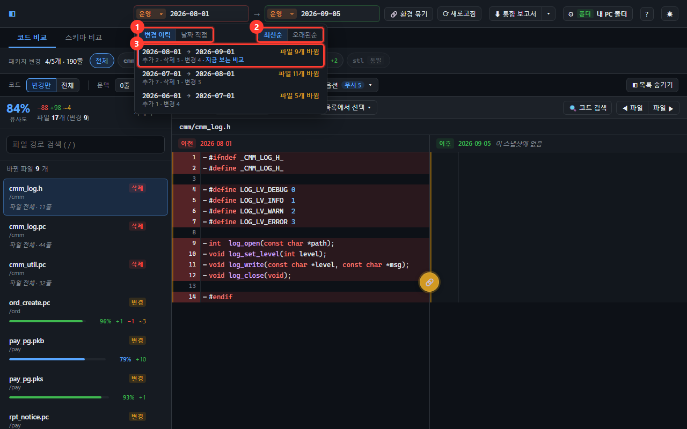

| | 자리 | 하는 일 |
| -- | ---- | ------- |
| ① | 변경 이력 / 날짜 직접 | 바뀐 일을 한 쌍씩 고를지, 이 칸 날짜만 고를지 (처음은 **변경 이력**) |
| ② | 최신순 / 오래된순 | 목록 순서 (처음은 **최신순**) |
| ③ | 변경 한 줄 | `이전 → 이후` · 바뀐 수, 아래 줄에 추가·삭제·변경 수. 지금 보는 비교에는 `지금 보는 비교` 가 붙습니다 |

```
[변경 이력 | 날짜 직접]                     [최신순 | 오래된순]
2026-08-01 → 2026-09-01              파일 9개 바뀜
추가 2 · 삭제 3 · 변경 4 · 지금 보는 비교
2026-07-01 → 2026-08-01             파일 11개 바뀜
추가 7 · 삭제 1 · 변경 3
```

- **줄에 적힌 숫자가 그대로 화면 결과**입니다. 그 줄을 누르면 왼쪽 목록에 바로 그만큼이 나옵니다.
- 배포가 없던 날(앞 날짜와 똑같은 폴더)은 앞 배포일과 내용이 같아서 **따로 줄이 생기지 않습니다.**
  쌍의 앞쪽은 그 내용이 처음 생긴 배포일입니다 — 08-15 가 08-01 과 같으면 `08-15 → 09-01` 이 아니라 `08-01 → 09-01`.
- **처음 열면 가장 최근 변경**이 골라져 있습니다. 최신 날짜와 그 바로 앞 날짜가 똑같은 폴더라
  빈 화면이 뜨는 일이 없게 하려는 것입니다(날짜를 직접 고른 뒤에는 손대지 않습니다).
- **날짜 직접** 탭은 이 칸만 고릅니다 — 여러 배포를 건너뛰어 보거나(06-01 → 09-01) 아무 날짜끼리 견줄 때 씁니다.
  모든 날짜가 나오고, 배포일에는 점과 `이날 파일 9개` 가 흐리게 붙습니다(그날 들어온 변경 수입니다 —
  "이걸 고르면 생길 차이" 가 아닙니다).
- **환경이 다를 때**(운영 → 테스트)는 시간 순서가 없어 변경 이력이 없고 날짜 직접만 나옵니다.
  맨 위의 **`운영 최신 ↔ 테스트 최신`** 을 누르면 양쪽 최신이 한 번에 골라집니다.
- **검색은 따로 갑니다.** 칸에 직접 치면 보기와 상관없이 **이 칸의 전체 날짜에서** 찾습니다 (`0815` → `2026-08-15`).
- 코드 탭의 숫자는 **파일 개수** 입니다. 한 글자라도 다르면 바뀐 파일로 세고(공백·주석 무시 옵션은 적용하지 않습니다),
  팀 제외 목록에 걸린 파일은 세지 않습니다.
- 스키마 탭에서도 똑같이 동작하고, 숫자는 **테이블 개수** 입니다(`테이블 4개 바뀜`). `SYS_C…` 같은 시스템 이름 제약은
  DB 마다 번호가 달라 세지 않습니다(7-3 참고). 스키마 제외 목록·종류 토글은 이 숫자에는 적용되지 않습니다.

> 날짜 칸 클릭 ➡️ 변경 이력에서 한 줄 누르기 (여러 배포를 건너뛰려면 날짜 직접)

### 날짜를 키보드로 입력하기

날짜 칸을 클릭하고 **그냥 타이핑**하면 됩니다. 목록을 일일이 스크롤하지 않아도 됩니다.

| 이렇게 치면 | |
| ---------- | -- |
| `2026-08-01` | 폴더명 그대로 |
| `20260801` | **표기법이 달라도 됩니다.** 폴더가 `2026-08-01` 이어도 찾아줍니다 (반대도 마찬가지) |
| `08-01` · `06` | 일부만 쳐도 해당하는 폴더가 **하나뿐이면** 찾아줍니다 |

- **Enter** 를 누르거나 다른 곳을 클릭하면 확정됩니다. 확정되면 **실제 폴더명으로 바뀝니다.**
- 칸을 누르거나 **↓** 를 누르면 목록이 펼쳐집니다. **↓ ↑** 로 줄을 훑고 **Enter** 로 고릅니다 (변경 이력 줄이면 두 칸이 함께).
- 어느 폴더로도 해석되지 않으면 칸이 **빨갛게** 표시되고, 확정할 때 원래 값으로 되돌아갑니다.
- **Esc** 를 누르면 입력을 취소하고 원래 값으로 돌아갑니다.

### 이후 칸의 날짜 직접 목록에 날짜가 몇 개 안 보입니다

**양쪽이 같은 환경일 때만** 그렇습니다. 이후는 항상 이전보다 최신이어야 하므로,
이후 칸의 **날짜 직접** 목록에는 고른 이전보다 **뒤(최신)에 있는 날짜만** 나옵니다.
**변경 이력** 탭은 두 칸을 함께 정하므로 이 제한과 상관없이 모든 변경이 나옵니다.

```
이전을 2026-07-01 로 고르면  →  이후 목록: 2026-08-01
이전을 2026-06-01 로 고르면  →  이후 목록: 2026-08-01, 2026-07-01
```

더 많은 날짜를 이후에서 고르고 싶으면 **이전을 더 예전 날짜로** 내리면 됩니다.

**환경을 다르게 고르면 이 제한이 없습니다.** 그때는 양쪽 목록이 전부 나옵니다 —
운영과 테스트는 배포하는 날이 달라서, 날짜 순서를 따질 이유가 없기 때문입니다.

같은 이유로 **이전 목록에는 가장 최신 날짜가 나오지 않습니다.** 그것보다 뒤에 올 날짜가 없기 때문입니다.

이전을 이후보다 최신인 날짜로 옮기면, 이후가 **한 칸 더 최신 날짜로 자동으로 옮겨집니다.**

---

## 3. 어느 업무가 바뀌었는지 먼저 보기

날짜를 고르면 바로 아래에 **패키지 변경** 줄이 나타납니다.
파일을 하나하나 열어보기 전에, 어느 업무 폴더가 움직였는지 한눈에 봅니다.

```
패키지 변경  4/5개 · 249줄
[전체] [cmm 삭제 −3] [ord 변경 ~1] [pay 변경 ~2] [rpt 추가 +2] [stl 동일]
```

화면 전체에서 상태는 **추가 · 삭제 · 변경 · 동일** 네 가지 말만 씁니다 (스키마 · 보고서도 같습니다).
늘 **왼쪽 → 오른쪽**(화면 위 화살표 방향)으로 읽습니다.

| 표시 | 뜻 |
| ---- | -- |
| **추가** | 오른쪽에는 있고 왼쪽에는 없는 폴더입니다 (같은 환경이면 새로 생긴 폴더) |
| **삭제** | 왼쪽에는 있고 오른쪽에는 없는 폴더입니다 (같은 환경이면 사라진 폴더) |
| **변경** | 폴더 안의 파일이 하나라도 바뀌었습니다 |
| **동일** | 아무것도 바뀌지 않았습니다 (흐리게 표시) |
| `+숫자` | 추가된 파일 수 |
| `−숫자` | 삭제된 파일 수 |
| `~숫자` | 변경된 파일 수 |

**칩을 누르면** 아래 파일 목록이 그 패키지만 남습니다. 한 번 더 누르면 전체로 돌아옵니다.

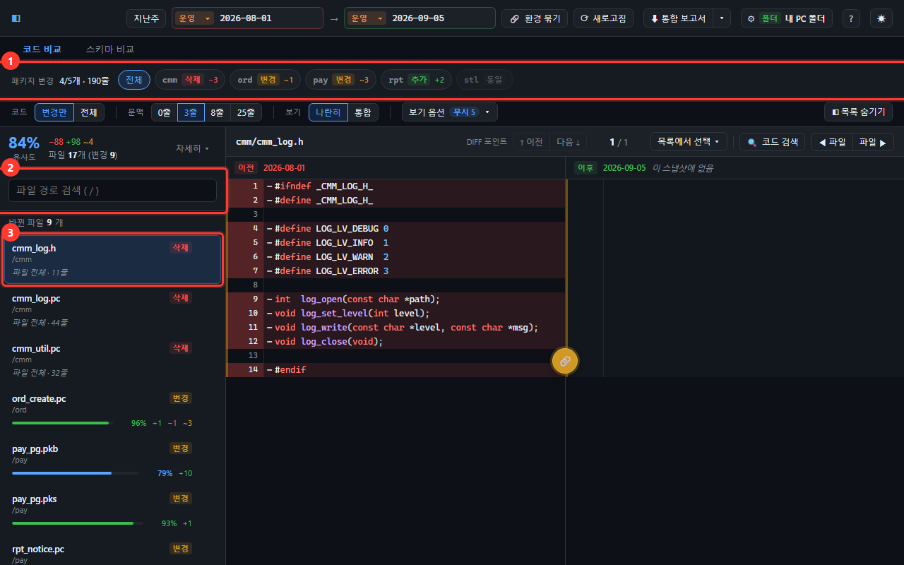

| | 자리 | 하는 일 |
| -- | ---- | ------- |
| ① | 패키지 변경 | 누르면 아래 목록이 그 업무 폴더만 남습니다 |
| ② | 파일 검색 | 파일명 일부로 찾습니다 — **동일한 파일까지 전체에서** 찾습니다 |
| ③ | 파일 하나 | 누르면 오른쪽에 코드가 열립니다 |

> ① 바뀐 업무 누르기 ➡️ ③ 파일 누르기 ➡️ 오른쪽에서 코드 확인

> 위 예시는 함께 들어있는 예시 폴더에서 **2026-08-01 → 2026-09-01** 을 고른 화면입니다.
> 추가·삭제·변경·동일 네 가지가 한 번에 나오므로, 표시가 어떻게 보이는지 확인해 보기 좋습니다.

---

## 4. 바뀐 파일 고르기

왼쪽 목록에서 파일을 고릅니다. 처음에는 **바뀐 파일만** 나옵니다.

```
cmm_log.pc      [변경]
cmm/
▓▓▓▓▓▓░░░  65%   +20  ~2
```

| 표시 | 뜻 |
| ---- | -- |
| **변경** | 양쪽에 다 있고 내용이 다릅니다 |
| **추가** | 오른쪽에는 있고 왼쪽에는 없습니다 — 둘째 줄에 `파일 전체 · 83줄` 처럼 크기가 나옵니다 |
| **삭제** | 왼쪽에는 있고 오른쪽에는 없습니다 |
| **동일** | 양쪽이 완전히 같습니다 |
| 막대 + `%` | 얼마나 닮았는지 (100% = 완전히 같음) |
| `+20 ~2` | 추가된 줄 20, 변경된 줄 2 (`−` 는 삭제된 줄) |

바뀌지 않은 파일은 목록 **맨 아래에 한 줄로 접혀** 있습니다.

```
rpt_daily.pc     추가
──────────────────────────────
▾ 동일한 파일 8개 — 펼치기
```

- 누르면 바뀐 파일 아래로 동일한 파일이 펼쳐지고, 다시 누르면(`▴ … 접기`) 접힙니다.
- 날짜나 환경을 바꾸면 다시 접힙니다. 파일을 골라도 접히지 않습니다.
- `[` `]` 로 파일을 옮겨 다닐 때는 **지금 보이는 것만** 따릅니다 — 접혀 있으면 바뀐 파일만 돕니다.
- **검색은 접기와 상관없이 전체에서** 찾습니다. 검색어를 넣으면 바뀐 파일 중 맞는 것 아래에
  `동일한 파일 중 3개` 처럼 동일한 파일 중 맞는 것이 함께 나옵니다. 검색어를 지우면 다시 접힙니다.

> 예전의 **변경된 파일만** 체크박스는 이 접힘 줄로 바뀌었습니다.

#### 바뀐 파일이 하나도 없을 때

배포가 없던 날끼리 견주면 모든 파일이 동일합니다. 이때는 가운데에 **바뀐 파일이 없습니다** 안내가 뜹니다.

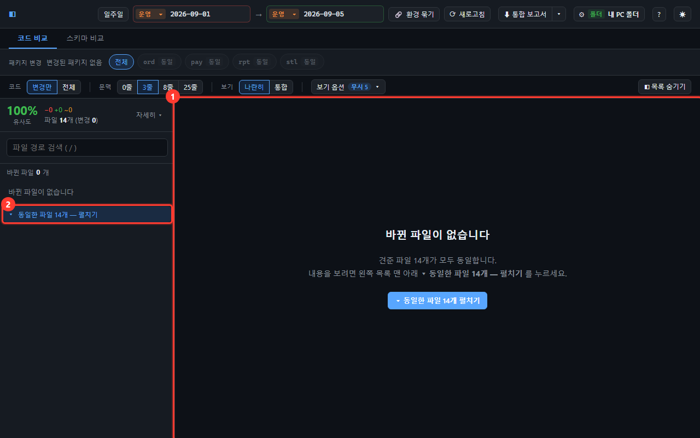

> ① 가운데 **▾ 동일한 파일 N개 펼치기** 클릭 (또는 ② 목록 맨 아래 접힘 줄 클릭) ➡️ 동일한 파일이 펼쳐지고 첫 파일이 열림

- 목록을 숨겨 둔 상태(`◧ 목록 숨기기`)에서도 가운데 버튼으로 펼칠 수 있습니다.
- 제외 목록으로 접힌 파일이 있으면 "제외로 접힌 파일 N개는 세지 않았습니다" 가 함께 나옵니다 —
  그 안에 바뀐 파일이 있을 수 있으니 필요하면 `· 제외 N` 을 눌러 펼쳐 보세요.

### 4-1. 늘 안 봐도 되는 파일 접어 두기

자동으로 만들어지는 파일이나 남의 코드처럼 **매번 봐도 소용없는 파일**이 목록 앞을 채우면
정작 볼 파일이 뒤로 밀립니다. 그런 파일을 텍스트 파일에 적어 두면 목록에서 접힙니다.

> ① 메모장으로 `exclude.txt` 를 만들어 파일 이름 적기 ➡️ ② **⚙ 설정 → 제외 규칙** 탭의 **팀 제외 목록 파일** 에 그 경로 넣기 ➡️ ③ **적용**

```
# 왜 뺐는지 이렇게 적어 둘 수 있습니다
*_common.h, *_bak.pc
rpt
```

| 이렇게 적으면 | 이런 파일이 접힙니다 |
| ------------ | ------------------ |
| `ord_create.pc` | 이름이 같은 파일 — **어느 폴더에 있든** |
| `*_bak.pc` | `_bak.pc` 로 끝나는 파일 전부 |
| `rpt` | `rpt` 폴더 **아래 전부** |
| `ord/tmp` | `ord` 밑의 `tmp` 폴더만 (다른 자리의 `tmp` 는 그대로) |

- 항목은 **쉼표**나 **줄바꿈**으로 구분합니다. 섞어 써도 됩니다.
- `#` 로 시작하는 줄은 설명이라 규칙이 되지 않습니다.
- 대소문자는 가리지 않습니다.
- 파일 내용을 고친 뒤에는 화면 오른쪽 위 **⟳ 새로고침** 을 누르면 다시 읽습니다.

#### 지우는 것이 아니라 접는 것입니다

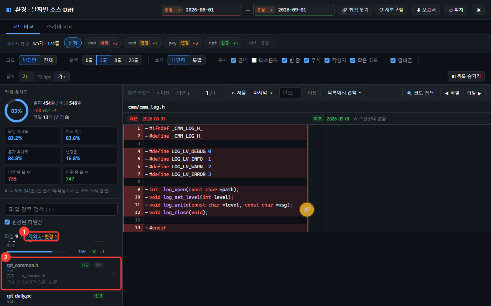

| | 자리 | 하는 일 |
| -- | ---- | ------- |
| ① | `제외 4 · 변경 1` | 몇 개를 접었는지, **그중 몇 개가 실제로 바뀌었는지**. 누르면 펼쳐집니다 |
| ② | 접힌 파일 | 흐리게 남아 있고, 아래에 **어느 규칙에 걸렸는지** 적혀 있습니다 |

**`· 변경 N` 이 노란색으로 뜨면 한 번은 열어 보세요.** 접어 둔 자리에 진짜 변경이
들어왔다는 뜻입니다. 이것 때문에 제외한 파일을 목록에서 아예 지우지 않습니다 —
운영과 테스트가 얼마나 벌어졌는지 보려고 여는 화면에서 "안 보이는 파일" 은 사고가 됩니다.

> 접은 파일도 **비교는 그대로 합니다.** 그래서 읽는 양이 줄지는 않습니다.
> 아예 읽지 않게 하려면 `change/config.ts` 의 `SCAN` 에서 대상 확장자를 좁히세요.

---

### 4-2. 이 파일만 잠깐 안 보고 싶습니다

파일 목록에서 그 항목의 **⊘** 버튼을 누르면 접힙니다.
**이 브라우저에만 저장되고**, 팀이 함께 쓰는 제외 목록 파일은 건드리지 않습니다.

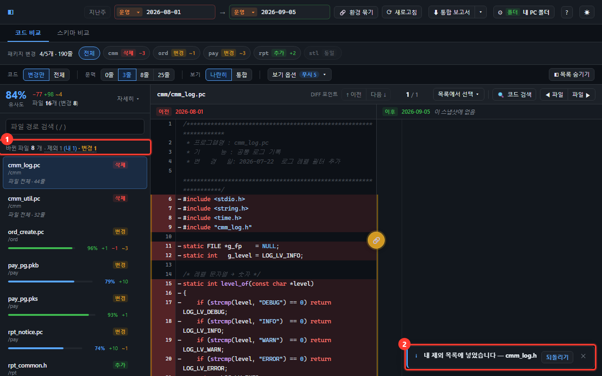

| | 자리 | 하는 일 |
| -- | ---- | ------- |
| ① | `· 제외 N (내 N)` | 접어 둔 파일 수. 누르면 접힌 파일을 펼쳐 봅니다 |
| ② | 알림 | 무엇을 접었는지 알려 줍니다. **되돌리기** 를 누르면 바로 원래대로 돌아옵니다 (6초 뒤 사라짐) |

알림이 사라진 뒤 되돌리려면 ① **제외 N** 을 눌러 펼친 다음 그 항목의 **↩** 를 누릅니다.

여러 개를 한꺼번에 적거나 `*_bak.pc` 같은 규칙을 쓰려면
**⚙ 설정 → 제외 규칙 → 내 제외 목록** 에서 편집하고 **적용** 을 누르세요.

> 규칙 파일 때문에 접힌 파일은 ⊘ 가 눌리지 않습니다 — 고칠 자리가 다릅니다.
> 그때는 **⚙ 설정 → 제외 규칙** 의 **팀 제외 목록 파일** 을 고치세요.

---

## 5. 코드 비교 보기

파일을 고르면 오른쪽에 좌우로 코드가 펼쳐집니다.
**왼쪽이 기준, 오른쪽이 견줄 쪽**입니다 — 각 칸 머리에 어디의 언제인지가 적혀 있습니다.

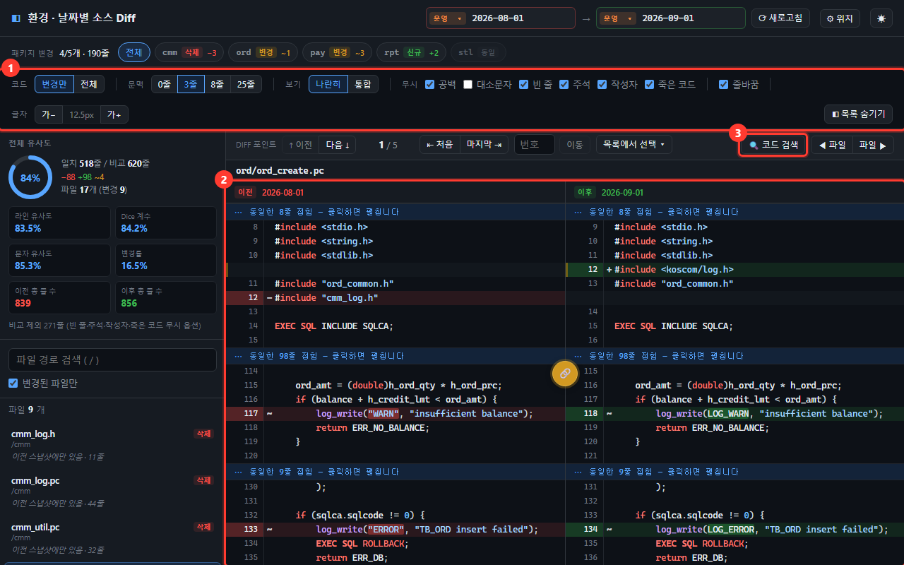

| | 자리 | 하는 일 |
| -- | ---- | ------- |
| ① | 옵션 바 | 보이는 범위·보기 방식, **보기 옵션**(무시할 차이·줄바꿈·글자 크기)을 정합니다 (아래 5-1, 6번) |
| ② | 좌우 코드 | 칸 머리에 `이전 2026-08-01` 처럼 어디의 언제인지가 나옵니다 |
| ③ | 코드 검색 | 열린 파일 안에서 글자를 찾습니다 (`Ctrl+F`) |

| 색 | 뜻 |
| -- | -- |
| 빨강 (왼쪽) | **삭제** — 왼쪽에는 있고 오른쪽에는 없는 줄 |
| 초록 (오른쪽) | **추가** — 오른쪽에는 있고 왼쪽에는 없는 줄 |
| 줄 안의 진한 색 | 그 줄에서 실제로 바뀐 부분 |

> 색과 말은 파일 목록 · 스키마 · 보고서와 같습니다. 같은 환경끼리 볼 때는 빨강이 **없어진 줄**,
> 초록이 **새로 생긴 줄** 입니다. 환경이 다를 때는 "한쪽에 있고 다른 쪽에 없다" 는 뜻일 뿐,
> 어느 쪽이 맞는 상태인지는 판단하지 않습니다.

### 5-1. 변경된 부분만 보기 / 전체 보기

옵션 바의 **코드** 항목에서 고릅니다.

```
코드  [변경만] [전체]
```

- **변경만** (처음 값) — 바뀐 줄과 그 주변만 보여주고 나머지는 접습니다.
  접힌 자리에 `▾ 동일한 8줄 접힘 — 클릭하면 펼칩니다` 가 나오고, **누르면 그 자리만 펼쳐집니다.**
  펼친 자리 맨 위에는 `▴ 동일한 8줄 펼침 — 클릭하면 다시 접습니다` 가 남아, **같은 자리를 다시 누르면 접힙니다.**
  30줄이 넘게 펼쳤으면 펼친 구간 **맨 아래**에도 접기 줄이 붙습니다 — 위로 올라가지 않고 접을 수 있고,
  접으면 접힌 줄이 화면 가운데로 옵니다.
- **전체** — 파일 처음부터 끝까지 다 보여줍니다. 색은 그대로 유지됩니다.

바뀐 줄 주변을 얼마나 함께 볼지는 **문맥** 에서 고릅니다.

| 값 | 보이는 범위 |
| -- | ---------- |
| **0줄** | 바뀐 줄만 |
| **3줄** (처음 값) | 바뀐 줄 위아래 3줄까지 |
| **8줄** / **25줄** | 더 넓게 |

### 5-2. 좌우 함께 스크롤하기

두 패널 사이 가운데에 🔗 단추가 떠 있습니다.

- **켜짐** — 한쪽을 굴리면 반대쪽도 같이 움직입니다. (처음 값)
- **꺼짐** — 좌우를 따로 봅니다. 한쪽만 길게 훑어볼 때 씁니다.

### 5-3. 바뀐 곳으로 바로 이동하기

코드 바로 위 줄을 씁니다. **왼쪽에 지금 보는 파일 경로**, 오른쪽에 이동 버튼이 있습니다.

```
ord/ord_create.pc            DIFF 포인트  [↑ 이전] [다음 ↓]   3 / 7   [목록에서 선택 ▾] | [🔍 코드 검색] [◀ 파일] [파일 ▶]
```

화면이 좁으면 `DIFF 포인트` · `코드 검색` 글자가 접히고 버튼만 남습니다. 경로가 길면 끝이 `…` 로 줄고, 마우스를 올리면 전체가 나옵니다.

- **다음 ↓ / ↑ 이전** — 바뀐 곳을 차례로 넘깁니다 (`n` / `p`). 화면이 그 자리로 스크롤됩니다.
- **3 / 7** — 지금 7군데 중 3번째를 보고 있습니다.
- **목록에서 선택** — 바뀐 곳 전체를 번호 · 미리보기와 함께 나열합니다. 맨 처음 · 맨 끝 · 몇 번째든 눌러서 바로 갑니다.

스크롤을 손으로 굴려도 번호가 따라 바뀝니다.

### 5-4. 코드 안에서 찾기

**🔍 코드 검색** 을 누르거나 `Ctrl+F` 를 누릅니다.
대소문자 구분·정규식 옵션이 있고, 접혀 있는 줄도 함께 찾습니다.
찾은 자리가 접혀 있으면 자동으로 펼쳐집니다.

---

## 6. 비교 기준 조정하기

옵션 바의 **보기 옵션 ▾** 에서 "이 정도 차이는 같은 것으로 치자" 를 정합니다.
버튼의 **무시 N** 은 지금 켜 둔 무시 옵션 수입니다 — 끄면 그만큼 차이가 더 보입니다.

> **보기 옵션 ▾** 클릭 ➡️ ② 칸에서 옵션 켜고 끄기 (바로 반영) ➡️ 바깥을 누르거나 `Esc` 로 닫기

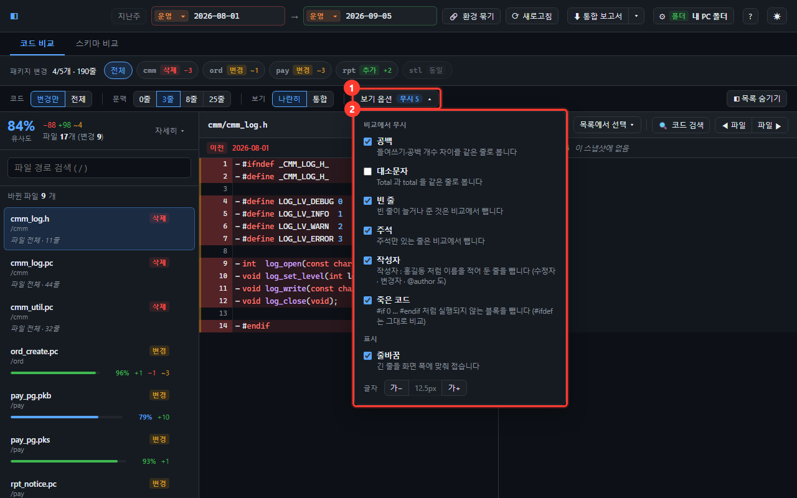

| | 자리 | 하는 일 |
| -- | ---- | ------- |
| ① | 보기 옵션 ▾ | 누르면 옵션 칸이 열립니다. 켜 둔 무시 옵션 수가 늘 보입니다 |
| ② | 옵션 칸 | 무시 6가지(이름 아래 한 줄 설명) · 줄바꿈 · 글자 크기 |

| 옵션 | 기본 | 켜면 |
| ---- | ---- | ---- |
| **공백** | 켜짐 | 들여쓰기나 띄어쓰기만 다른 줄을 같은 줄로 봅니다 |
| **대소문자** | 꺼짐 | 대소문자만 다른 줄을 같은 줄로 봅니다 |
| **빈 줄** | 켜짐 | 빈 줄을 비교에서 뺍니다 (화면에는 흐리게 남습니다) |
| **주석** | 켜짐 | 주석만 있는 줄을 비교에서 뺍니다 (화면에는 흐리게 남습니다) |
| **작성자** | 켜짐 | `작성자 : 홍길동` 처럼 이름을 적어 둔 줄을 뺍니다 |
| **죽은 코드** | 켜짐 | `#if 0` 처럼 실행되지 않게 막아 둔 블록을 통째로 뺍니다 |

포맷터를 돌렸거나 주석만 손댄 경우, 이 옵션을 켜면 **진짜 로직 변경만** 남습니다.

**처음부터 켜져 있습니다.** 보고 싶은 것은 로직 차이지 들여쓰기나 머리말이 아니라서,
공백·빈 줄·주석·작성자·죽은 코드를 무시한 상태로 엽니다. 대소문자만 꺼 둡니다 —
C 와 PL/SQL 에서 `Total` 과 `total` 은 서로 다른 이름이라 켜면 진짜 차이를 덮습니다.
**고친 값은 이 브라우저에 남아** 다음에 열 때도 그대로입니다.

그 밖에

- **보기** — `나란히` 는 좌우 2단, `통합` 은 한 줄로 위아래 비교
- **줄바꿈** (보기 옵션 안) — 긴 줄을 접어서 볼지, 가로로 스크롤할지
- **◧ 목록 숨기기** — 왼쪽 목록을 접어 코드를 넓게 봅니다
- **☀ / ☾** — 밝은 화면 / 어두운 화면

> 한글 주석이 깨져 보이면 **⚙ 설정 → 위치 → 소스 인코딩** 을 확인하세요 (아래 10번 참고).

### 무시되는 주석의 범위

여러 줄에 걸친 주석도 통째로 빠집니다 — 아래 세 줄이 전부 주석으로 잡힙니다.

```c
/*****
 주석값
 *****/
```

- `/* */` · `//` · SQL 의 `--` 를 봅니다.
- `#include` 같은 전처리기 줄은 주석이 아니므로 **그대로 비교합니다.**
- 문자열 안에 들어 있는 주석 기호(`strcpy(buf, "/*")`)는 주석으로 보지 않습니다.
- **코드 뒤에 붙은 주석은 함께 비교합니다** — 그 줄에는 코드가 있으니까요.
  `x = 1; /* 설명 */` 에서 설명만 바뀌면 그 줄은 변경으로 잡힙니다.

### 작성자 줄이란

`작성자` · `수정자` · `변경자` · `만든이` 뒤에 `:` 가 오는 줄입니다.
`작 성 자 :` 처럼 글자를 벌려 쓴 표기도 잡고, 앞에 주석 기호가 붙어 있어도 됩니다.
`@author` 는 이름이 바로 오는 표기라 `:` 없이도 잡습니다.

`:` 를 요구하는 이유는 코드에 우연히 들어간 낱말과 가르기 위해서입니다 —
`strcpy(author, ...)` 같은 줄은 빠지지 않습니다.

> **주석** 을 켜면 머리말 주석 안의 작성자 줄도 어차피 빠집니다.
> **작성자** 를 따로 둔 것은 주석은 보면서 이름 줄만 빼고 싶을 때를 위해서입니다.

### 죽은 코드란

주석이 아니라 **조건부 컴파일**이지만, 조건이 거짓으로 못박혀 있어 실행될 일이 없는
블록입니다. 블록 주석(`/* */`)은 겹쳐 쓸 수 없어서, 여러 줄을 한꺼번에 죽여 둘 때
예부터 이 방법을 씁니다.

```c
#if 0
    old_call();      ← 이 세 줄이 통째로 빠집니다
#endif
```

Oracle 패키지(.pks/.pkb)의 `$IF FALSE $THEN` … `$END` 도 같은 규칙으로 봅니다.

**빌드 옵션에 따라 살아나는 것은 건드리지 않습니다.**

| 이렇게 쓰면 | |
| ---------- | -- |
| `#if 0` · `#if FALSE` · `$IF FALSE $THEN` | **뺍니다** — 어떤 빌드에서도 안 돕니다 |
| `#ifdef DEBUG` · `#if VERSION > 2` | **비교합니다** — 빌드에 따라 실제로 도는 코드입니다 |
| `#ifndef ORD_H` (헤더 가드) | **비교합니다** |
| `#if 0` 안의 `#else` 가지 | **비교합니다** — 죽은 쪽은 `#if 0` 가지뿐입니다 |

- 안에 다시 `#if` 가 열려 있어도 짝을 세어 맞는 `#endif` 까지 뺍니다.
- 주석이나 문자열 안에 적힌 `#if 0` 에는 속지 않습니다.
- `#ifdef NEVER` 처럼 **이름으로만** 죽여 둔 것은 빼지 않습니다 — 그 이름이 어딘가에
  정의돼 있는지 이 도구가 알 길이 없어서입니다.

### 6-1. 코드 글자 크기 바꾸기

옵션 바의 **보기 옵션 ▾** 안 맨 아래 **글자** 항목을 씁니다 (스키마 비교는 옵션 바에 바로 있습니다).

```
글자  [가−] [12.5px] [가+]
```

- **가+ / 가−** — 0.5px 씩 키우고 줄입니다 (10px ~ 22px).
- **가운데 숫자** — 누르면 기본 크기(12.5px)로 돌아갑니다.

고른 크기는 저장되어 다음에 열 때도 그대로입니다.
브라우저 확대(Ctrl+휠)와 달리 **코드 영역 글자만** 커지고 메뉴는 그대로입니다.

---

## 7. 데이터 스키마 비교하기

화면 위 **`스키마 비교`** 탭을 누르면 같은 좌우 선택으로 **DB 테이블 정의**를 견줍니다.

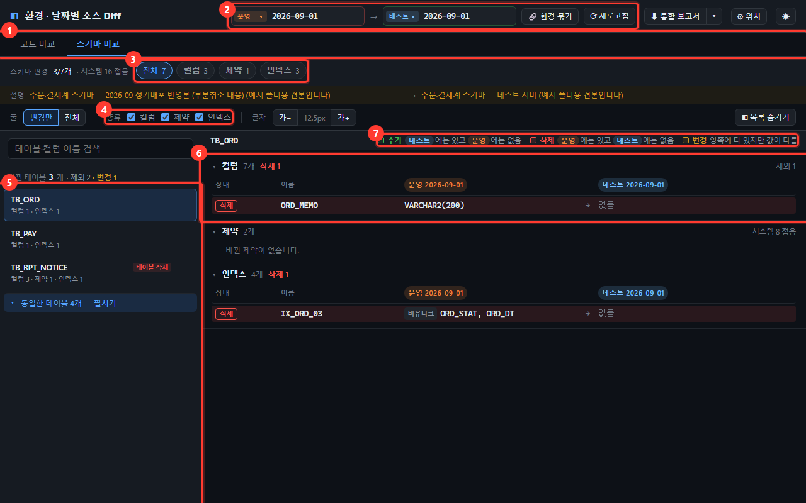

| | 이름 | 하는 일 |
| -- | ---- | ------- |
| ① | 모드 탭 | 코드 비교 / 스키마 비교 |
| ② | 비교할 곳 고르기 | **코드 비교와 같은 칸**입니다 → [7-2](#7-2-날짜는-위에서-똑같이-고릅니다) |
| ③ | 종류 필터 | 컬럼·제약·인덱스가 바뀐 테이블만 추립니다 → [7-5](#7-5-종류-칩으로-좁히기) |
| ④ | 종류 토글 | 한 종류를 통째로 끕니다 → [7-7](#7-7-안-볼-테이블컬럼-접어-두기) |
| ⑤ | 테이블 목록 | 누르면 오른쪽에 정의가 열립니다 |
| ⑥ | 컬럼·제약·인덱스 | 고른 테이블의 좌우 차이 → [7-1](#7-1-무엇을-보여주나) |
| ⑦ | 색 · 말 범례 | 초록 **추가** · 빨강 **삭제** · 주황 **변경** 이 무엇을 뜻하는지 지금 고른 이름(열 머리와 같은 색 태그)으로 풀어 줍니다 |

> 이 탭이 안 보이거나 "설정돼 있지 않습니다" 가 뜨면, `change/config.ts` 의 프리셋에
> **schemaRoot** 가 비어 있는 것입니다. 스키마 덤프가 쌓이는 폴더 경로를 적으면 켜집니다.

### 7-1. 무엇을 보여주나

왼쪽에 **테이블 목록**, 오른쪽에 고른 테이블의 **컬럼 · 제약 · 인덱스** 세 묶음이 나옵니다.

```
컬럼 8개   추가 1 · 삭제 1 · 변경 1
상태          이름          운영 2026-08-01   →  운영 2026-09-01
              ORD_NO        VARCHAR2(20)  NOT NULL
[타입 변경]   ORD_AMT       NUMBER(15,2)      →  NUMBER(18,2)
[추가]        ORD_MEMO      없음              →  VARCHAR2(200)
[삭제]        ORD_OLD_FLG   CHAR(1)           →  없음
```

- 줄 색과 상태 칸의 말은 **세 가지뿐**이고, 늘 **왼쪽 → 오른쪽**(화면 위 화살표 방향)으로 읽습니다.
  보고서에 나오는 말과 같습니다.

  | 색 | 말 | 뜻 (운영 → 테스트 일 때) | 뜻 (운영 8/1 → 9/1 일 때) |
  | -- | -- | ---------------------- | ------------------------ |
  | 초록 | **추가** | 테스트에는 있고 운영에는 없음 | 9/1 에 새로 생김 |
  | 빨강 | **삭제** | 운영에는 있고 테스트에는 없음 | 9/1 에서 없어짐 |
  | 주황 | **변경** (`타입 변경` · `NOT NULL 설정/해제` · `종류 변경` · `컬럼 변경`) | 양쪽에 다 있지만 값이 다름 | 값이 바뀜 |

  이 뜻은 **표 이름 줄 오른쪽의 범례**에 지금 고른 이름으로 늘 적혀 있습니다
  (예: `삭제 — 운영에는 있고 테스트에는 없음`). 범례 속 `운영` · `테스트` 는 **열 머리와 같은 색 태그**(운영 주황 ·
  테스트 하늘색)라, 어느 쪽 열 이야기인지 색으로 바로 이어집니다.
- 환경이 다를 때 `추가` · `삭제` 는 **"한쪽에 있고 다른 쪽에 없다"** 는 뜻일 뿐, 어느 쪽이 맞는 상태인지는
  판단하지 않습니다. 테스트에 먼저 넣은 것인지 운영 반영이 빠진 것인지는 보는 사람이 판단합니다.
- 한쪽에 없는 값은 **없음** 으로 적힙니다. 마우스를 올리면 어느 쪽에 없는지 나옵니다.
- 왼쪽 **테이블 목록**에는 테이블마다 바뀐 줄 수가 종류별로 나옵니다 (`컬럼 4 · 제약 1 · 인덱스 2`).
  테이블이 통째로 한쪽에만 있을 때만 `테이블 추가` · `테이블 삭제` 표시가 붙습니다.
- 왼쪽 값 → 오른쪽 값을 **한 줄에** 보여줍니다.
- 바뀌지 않은 줄은 값을 한 번만 적고 흐리게 둡니다.
- 타입 뒤의 회색 **NOT NULL** 표시는 그 컬럼에 **빈 값을 넣을 수 없다**는 뜻입니다.
  마우스를 올리면 설명이 뜹니다. 널을 허용하는 컬럼에는 아무것도 안 적습니다 —
  그쪽이 보통이라 둘 다 적으면 정작 봐야 할 것이 묻힙니다.
- 이 표시가 **붙거나 풀린 것도 변경으로 잡습니다.**

옵션 바의 **전체** 를 누르면 바뀌지 않은 줄까지 다 보입니다 (기본은 **변경만**).

### 7-2. 날짜는 위에서 똑같이 고릅니다

**코드 비교와 같은 자리**입니다. 화면 맨 위의 환경·날짜 칸을 그대로 씁니다.

- 양쪽을 **다른 환경**으로 두면 운영 ↔ 테스트 비교 (기본값)
- 양쪽을 **같은 환경**으로 두면 그 환경의 두 날짜 비교 (운영↔운영 · 테스트↔테스트)

스키마 덤프는 소스 배포와 **주기가 달라** 날짜 목록이 코드와 다릅니다. 그래서 탭마다
고른 날짜를 따로 기억합니다 — 코드 탭에서 날짜를 바꿔도 스키마 탭 쪽은 그대로입니다.

스키마 탭을 **처음 열 때**는 코드에서 보고 있던 날짜에 맞춰 줍니다. 딱 맞는 덤프가 없으면
**날짜가 가장 가까운 것**을 고릅니다. 앞이든 뒤든 가까운 쪽이고, 거리가 같으면 앞의 것입니다.

스키마 탭의 날짜가 코드 탭과 다르면 탭 위에 파란 안내 줄이 뜹니다
(예: `소스 비교(08-01 → 09-05)와 날짜가 다릅니다 … 08-01 → 09-01 덤프를 보고 있습니다`).

> 글자 크기는 옵션 바의 **가− / 가+** 로 바꿉니다. 코드 비교와 같은 값을 씁니다.

### 7-3. "시스템 N 접음" 은 무슨 뜻인가요

오라클은 `NOT NULL` 컬럼마다 제약을 자동으로 만들고 **`SYS_C0011234` 같은 번호 이름**을 붙입니다.
이 번호는 **데이터베이스마다 다릅니다.** 그래서 접지 않으면 운영과 테스트가 내용이 똑같아도
제약 수백 개가 전부 "변경" 으로 떠서 화면을 볼 수가 없습니다.

그래서 이런 이름은 목록에서 접고, **몇 개를 접었는지만 남깁니다.**
NOT NULL 여부는 컬럼 줄에 그대로 있으니 놓치는 정보는 없습니다.

사람이 이름을 붙인 제약(`PK_ORD` · `FK_ORD_CUST` · `CK_PAY_MTHD`)은 접지 않습니다.

### 7-4. ⚠ 기본키 표시

기본키가 바뀐 테이블에는 목록과 제목에 **⚠ 기본키** 가 붙습니다.
자주 있는 일은 아니지만 생기면 데이터 이관·중복을 반드시 함께 확인해야 하는 변경입니다.

새로 생기거나 없어진 테이블에는 붙지 않습니다 — 거기서는 당연한 일이라, 표시가 흔해지면
정작 봐야 할 것이 묻힙니다.

### 7-5. 종류 칩으로 좁히기

위쪽 **컬럼 / 제약 / 인덱스** 칩을 누르면 그 종류가 바뀐 테이블만 목록에 남습니다.
"이번에 인덱스만 손댄 테이블" 을 뽑아 볼 때 씁니다. 다시 누르면 풀립니다.

왼쪽 검색창은 **컬럼 이름도 함께** 찾습니다 — `ORD_AMT` 를 넣으면 그 컬럼이 있는 테이블이 나옵니다.

바뀌지 않은 테이블은 코드 쪽과 같이 목록 **맨 아래 `▾ 동일한 테이블 N개 — 펼치기`** 로 접혀 있고,
검색은 접기와 상관없이 전체에서 찾습니다(`동일한 테이블 중 N개`). 예전의 **변경된 테이블만** 체크박스를 대신합니다.
바뀐 테이블이 하나도 없으면 코드 쪽과 같이 가운데에 **바뀐 테이블이 없습니다** 와 펼치기 버튼이 뜹니다.

### 7-6. "못 읽은 줄" 이 뜹니다

덤프의 구분자가 설정과 다를 때 나옵니다.
`change/config.ts` 의 `SCHEMA.separator` 가 실제 파일의 구분자(`|` 또는 `,`)와 맞는지 확인하세요.

---

### 7-7. 안 볼 테이블·컬럼 접어 두기

세 가지 방법이 있습니다.

**① 목록·표에서 바로** — 테이블 목록이나 컬럼·제약·인덱스 줄의 **⊘** 를 누르면 접힙니다.
이 브라우저에만 저장됩니다. 누르면 오른쪽 아래 알림의 **되돌리기** 로 바로 되돌릴 수 있고,
알림이 사라진 뒤에는 위의 **제외 N** 을 눌러 펼친 다음 **↩** 를 누릅니다.

**② 종류 통째로** — 옵션바의 `컬럼 / 제약 / 인덱스` 체크를 끄면 그 종류가 전부 접힙니다.
"이번엔 인덱스 안 봄" 처럼 한 묶음을 치울 때 씁니다.

**③ 팀이 함께** — `⚙ 설정 → 제외 규칙 → 팀 스키마 제외 목록 파일` 에 경로를 적으면 그 파일의 규칙이
모두에게 적용됩니다. 백업 테이블처럼 누가 봐도 볼 필요 없는 것을 적습니다.

적는 법은 셋 다 같습니다.

```
TB_ORD_BAK        이 테이블과 그 안의 전부
TB_ORD.ORD_MEMO   이 테이블의 이 컬럼만
*.REG_DTM         모든 테이블의 REG_DTM (등록일시 같은 감사 컬럼)
IX_*_TMP          이름이 맞는 인덱스·제약
```

> **지우는 게 아니라 접는 것입니다.** 접은 것 중에 바뀐 것이 있으면
> `제외 5 (내 2) · 변경 1` 처럼 그 수를 함께 알립니다. 눌러서 펼쳐 확인하세요.

> 팀 규칙 파일에 적혀 접힌 것은 ⊘ 가 눌리지 않습니다 — 그건 파일을 고쳐야 합니다.

---

## 8. 보고서 내려받기

지금 보고 있는 비교 결과를 **공지에 붙일 md 파일**로 받습니다. 통합 · 소스 · 스키마 세 가지가 있습니다.

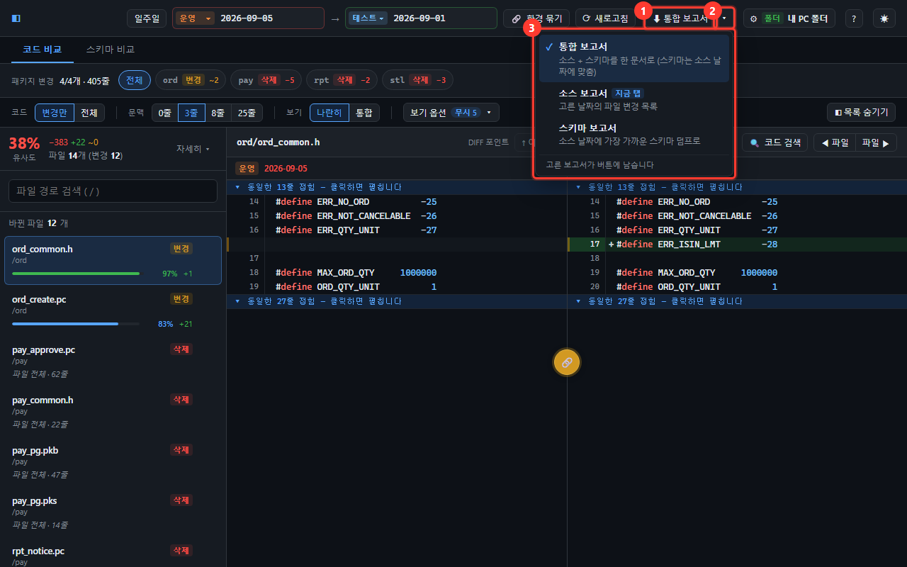

| | 자리 | 하는 일 |
| -- | ---- | ------- |
| ① | **⬇ 통합 보고서** | 버튼에 적힌 보고서를 바로 받습니다. 처음은 **통합** 입니다 |
| ② | **▾** | 다른 보고서를 고르는 메뉴를 엽니다 |
| ③ | 보고서 메뉴 | 통합 · 소스 · 스키마 중에서 고릅니다. **고른 보고서가 ① 버튼에 남습니다** (✓ 표시). 지금 탭에는 `지금 탭` 이 붙고, 받을 수 없는 것은 흐리게 이유와 함께 나옵니다 |

> 비교할 곳 고르기 ➡️ ① 클릭 ➡️ 받은 `.md` 파일을 공지에 붙여넣기
>
> 다른 보고서가 필요하면 ② ➡️ ③ 에서 고르기 — 다음부터는 ① 한 번으로 그 보고서가 받아집니다.

- 고른 보고서는 이 브라우저에 남아, 다음에 열어도 그대로입니다.
- 스키마 위치를 설정하지 않았으면 ① 은 **소스 보고서**로 바뀝니다 (통합·스키마는 받을 수 없어서).

| 보고서 | 담기는 것 | 스키마 날짜 |
| ------ | --------- | ----------- |
| 통합 보고서 | 소스 + 스키마를 한 문서로 | 소스 날짜에 가장 가까운 덤프 (한 문서 안에서 시점이 어긋나지 않게) |
| 소스 보고서 | 고른 날짜의 파일 변경 | — |
| 스키마 보고서 | 테이블·컬럼·인덱스 변경 | 스키마 탭에서 받으면 **화면에 보이는 날짜 그대로**, 코드 탭에서 받으면 소스 날짜에 가장 가까운 덤프 |

파일 이름에 종류가 들어갑니다 — `비교보고서_소스_…` · `비교보고서_스키마_…` · `비교보고서_통합_…`.
스키마 위치를 설정하지 않았으면 스키마·통합은 메뉴에서 잠겨 있습니다.

통합 보고서는 아래처럼 생겼습니다.

```markdown
# 소스·스키마 비교 보고서 (운영 ↔ 테스트)

| 환경 | 종류 | 변경 건수 | 날짜 |
| ---- | ---- | -------: | ---- |
| 운영 → 테스트 | 소스 | 12건 | 2026-09-01 |
| 운영 → 테스트 | 스키마 | 3건 | 2026-09-01 |

## 소스 변경 내역

| 파일 | 줄 수 | 상태 |
| ---- | ---- | ---- |
| pay/pay_approve.pc | −87줄 | 삭제 |
| ord/ord_create.pc | +21줄 | 변경 |

## 스키마 변경 내역

> 추가: 테스트에는 있고 운영에는 없음 · 삭제: 운영에는 있고 테스트에는 없음 · 변경: 양쪽에 다 있지만 값이 다름

| 테이블 | 구분 | 이름 | 내용 | 상태 |
| ------ | ---- | ---- | ---- | ---- |
| TB_RPT_NOTICE | 테이블 | — | 컬럼: NOTICE_NO, TITLE, BODY · 제약: PK_RPT_NOTICE · 인덱스: PK_RPT_NOTICE | 테이블 삭제 |
| TB_ORD | 컬럼 | ORD_MEMO | VARCHAR2(200) | 삭제 |
| TB_ORD | 인덱스 | IX_ORD_03 | 비유니크 (ORD_STAT, ORD_DT) | 삭제 |
| TB_PAY | 컬럼 | APRV_NO | VARCHAR2(30) NOT NULL → VARCHAR2(30) | NOT NULL 해제 |
```

- **상태는 표의 맨 끝 칸**에 있습니다. 소스와 스키마 모두 **추가 · 삭제 · 변경** 으로 같은 말을 씁니다.
  스키마의 상태 말은 화면 줄 앞 칩과 같습니다 ([7-1](#7-1-무엇을-보여주나)) —
  `추가` · `삭제` · `타입 변경` · `NOT NULL 설정/해제` · `종류·컬럼 변경` · `테이블 추가/삭제`.
- 스키마 **내용** 칸에는 값이 적힙니다. 한쪽에만 있으면 그 값, 바뀌었으면 `왼쪽 → 오른쪽`
  (`NUMBER(15,2) → NUMBER(18,2)`).
- 테이블이 통째로 생기거나 없어졌으면 개수가 아니라 **이름**으로 적힙니다
  (`컬럼: NOTICE_NO, TITLE, BODY · 제약: PK_RPT_NOTICE · 인덱스: …`). 공지를 받은 사람이 어떤 테이블인지 알 수 있게 하려는 것입니다.
- 스키마 절 바로 아래에 **말의 뜻이 실제 이름으로** 한 줄 적힙니다 (`> 추가: 테스트에는 있고 운영에는 없음 · …`).
  받는 사람이 "추가가 누구 기준이냐" 고 되묻지 않게 하려는 것입니다. 기본키가 걸린 줄에는 앞에 **⚠ 기본키** 가 붙습니다.
- 맨 위 표의 스키마 **변경 건수는 바뀐 테이블 수**입니다. 한 테이블에서 여러 항목이 바뀌면 아래 목록에는 여러 줄로 나옵니다.

- **통합 보고서의 스키마 날짜는 코드에서 고른 날짜에 가장 가까운 덤프**로 맞춥니다
  ([7-2](#7-2-날짜는-위에서-똑같이-고릅니다)와 같은 규칙). 스키마 탭에서 따로 고른 날짜는 쓰지 않습니다 —
  한 보고서 안에서 소스와 스키마가 다른 시점을 말하지 않게 하려는 것입니다.
- **같은 날짜의 덤프가 없으면 표 아래에 적힙니다.** 예: `※ 스키마는 같은 날짜의 덤프가 없어 가장 가까운 덤프로 비교했습니다 (2026-07-01 대신 2026-07-03).`
- **두 날짜 사이에 덤프가 없으면 스키마는 비교하지 않습니다.** 같은 환경의 6/1 → 7/1 을 보는데 덤프가 8/1 뿐이면
  두 날짜 모두 8/1 덤프로 맞춰져 견줄 것이 없습니다. 이때 변경 건수는 `—` 로 나오고 그 사유가 표 아래에 적힙니다.
  (`0건` 은 "견줘 보니 같다" 는 뜻이라 구분합니다)
- **숫자는 화면과 같습니다.** 제외 목록·내 목록으로 접어 둔 파일과 테이블은 보고서에서도 빠집니다.
- **코드 내용은 들어가지 않습니다.** 어떤 파일이 몇 줄 바뀌었는지만 적힙니다.
- 바뀐 것이 없는 종류는 표에 `0건` 으로만 나오고 아래 목록은 생략됩니다.
- 통합 보고서에서 스키마를 읽지 못하면 소스만 담아 내려받고, 화면 오른쪽 아래에
  **"스키마는 보고서에서 빠졌습니다"** 라고 알려 줍니다. 그대로 공지하면 스키마 변경이 없는 것처럼 읽히니 확인하세요.
  스키마 보고서에서 못 읽으면 담을 것이 없어 받지 않고 그 이유를 알려 줍니다.
- 파일 이름은 `비교보고서_통합_운영-2026-09-01_테스트-2026-09-01.md` 처럼 종류와 견준 곳이 들어갑니다.
- 비교가 끝나기 전에는 버튼이 눌리지 않습니다.

---

## 9. 단축키

오른쪽 위 **?** 버튼이나 `?` 키로 이 표와 화면 흐름 안내를 앱 안에서 바로 볼 수 있습니다.

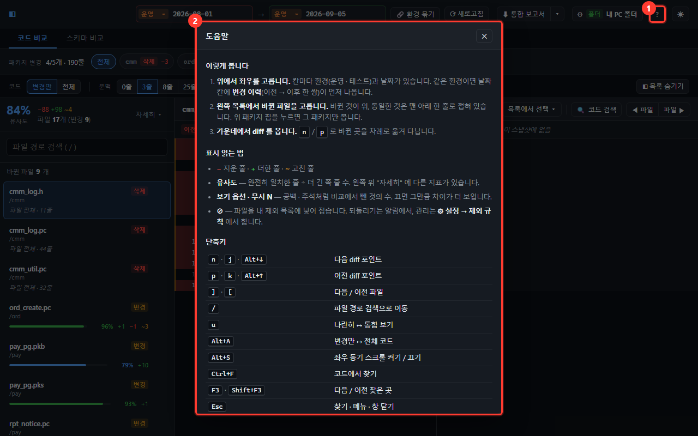

| 키 | 동작 |
| -- | ---- |
| `n` 또는 `j` | 다음 바뀐 곳 |
| `p` 또는 `k` | 이전 바뀐 곳 |
| `]` / `[` | 다음 / 이전 파일 |
| `u` | 나란히 ↔ 통합 |
| `/` | 파일 검색창으로 |
| `Ctrl+F` | 코드 검색 열기 |
| `F3` / `Shift+F3` | 다음 / 이전 검색 결과 |
| `Alt+S` | 좌우 함께 스크롤 켜기·끄기 |
| `Alt+A` | 변경만 ↔ 전체 |
| `?` | 도움말 (화면 흐름 · 표시 읽는 법 · 단축키) |

---

## 10. 이럴 땐 이렇게

### 화면 위에 빨간 줄로 "비교할 폴더를 찾을 수 없습니다" 가 뜹니다

경로가 틀렸습니다. 메시지에 나온 경로가 실제로 있는지 확인하세요.
**⚙ 설정** 에서 바로 고치거나, `change/config.ts` 의 프리셋을 고치면 됩니다.
둘 다 **다시 시작하지 않아도** 반영됩니다.

### 날짜 목록에 아무것도 안 나옵니다

지정한 폴더 **바로 아래**에 날짜 폴더가 있어야 합니다.
한 단계 더 들어가 있다면 경로를 그 안쪽으로 바꾸세요.

환경(**운영/테스트**)을 고른 상태라면 그 폴더 **안**만 보입니다. 좌우가 각각 고르므로
한쪽만 비어 있을 수도 있습니다 — 안내 문구에 어느 환경이 비었는지 나옵니다.
`change/config.ts` 의 `ENV_FOLDERS` 에 적은 폴더 이름이 실제와 같은지 확인하세요 —
없는 폴더를 가리키면 "비교할 폴더를 찾을 수 없습니다" 가 그 경로와 함께 뜹니다.

### 파일이 목록에 안 보입니다

목록 위 표시를 먼저 보세요. 둘은 원인이 다릅니다.

| 표시 | 뜻 | 고칠 곳 |
| ---- | -- | ------ |
| `· 대상 밖 N` | 확장자가 대상이 아니거나 파일이 너무 큼 | `change/config.ts` 의 `SCAN` |
| `· 제외 N` | 제외 목록에 걸려 **접힌 것** — 누르면 펼쳐집니다 | 제외 목록 파일 ([4-1](#4-1-늘-안-봐도-되는-파일-접어-두기)) |
| `▾ 동일한 파일 N개` (목록 맨 아래) | 바뀌지 않아 **접힌 것** — 누르면 펼쳐집니다. 검색은 접혀 있어도 찾습니다 | 고칠 것 없음 ([4번](#4-바뀐-파일-고르기)) |

확장자를 늘리려면 `change/config.ts` 의 `SCAN` 에 추가하세요.

```ts
export const SCAN: ScanConfig = {
  extensions: ['pc', 'pch', 'h', 'sql', 'pks', 'pkb', 'c', 'cpp'],
  maxFileBytes: 2_000_000,   // 이보다 큰 파일은 제외
}
```

> `SCAN` 은 **개발 서버를 다시 시작해야** 반영됩니다 (`Ctrl+C` → `npm run dev`).

### `⚠ 제외 목록 오류` 가 뜹니다

적어 둔 제외 목록 파일을 읽지 못했습니다. 그 표시에 **마우스를 올리면** 이유가 나옵니다.
비교 자체는 정상이고, 다만 **아무것도 접히지 않은 상태**입니다.

- 경로를 잘못 적었을 때가 대부분입니다 — **⚙ 설정 → 제외 규칙** 의 `팀 제외 목록 파일` 을 확인하세요
- 내 PC 폴더라면 상대 경로는 **이 프로젝트 폴더 기준**입니다
- 제외 기능을 안 쓸 거라면 그 칸을 **비우면** 표시도 사라집니다

### 스키마 비교 탭에 "설정돼 있지 않습니다" 가 뜹니다

`change/config.ts` 의 프리셋에 **schemaRoot** 를 적으세요. 스키마 덤프가 쌓이는 폴더입니다.
그 아래는 환경 폴더(`prod` · `test`)로 갈리고, 그 안에 날짜별 파일이 하나씩 있어야 합니다.

### 스키마 날짜 목록이 비어 있습니다

파일 이름이 규칙과 다른 것입니다. `SCHEMA.fileName`(기본 `snapshot_{env}_{date}.txt`)이
실제 파일 이름과 맞는지 보세요 — `{env}` 는 환경 폴더명, `{date}` 는 날짜 자리입니다.
환경 폴더 이름은 `ENV_FOLDERS` 의 `path` 를 그대로 씁니다.

### 제외 목록에 적었는데 그대로 보입니다

- 파일을 고친 뒤 **⟳ 새로고침** 을 눌렀는지 확인하세요 (규칙은 한 번 읽어 두고 씁니다)
- `ord/tmp` 처럼 슬래시가 들어간 규칙은 **맨 위 폴더부터** 맞습니다.
  어디에 있든 걸리게 하려면 슬래시 없이 이름만 적으세요
- 구분자를 바꿔 두지 않았는지 보세요 (`change/config.ts` 의 `SCAN.excludeSeparators`)

### 폴더에 새 날짜를 넣었는데 목록에 없습니다

화면 오른쪽 위 **⟳ 새로고침** 을 누릅니다.
날짜 목록뿐 아니라 **파일 내용까지 다시 읽어** 비교를 새로 합니다 —
날짜는 그대로인데 그 안의 소스만 바뀐 경우에도 이 버튼입니다.

### "날짜 폴더가 1개뿐입니다" 가 뜹니다

**같은 환경끼리** 비교하려면 날짜 폴더가 2개 이상 있어야 합니다.

**한쪽 환경을 다르게 고르면 1개뿐이어도 비교됩니다.** 각자 하나씩만 있으면 되기 때문입니다 —
안내 문구에도 "다른 환경을 고르면 그쪽과 견줄 수 있습니다" 가 함께 나옵니다.

환경 폴더 안이라 1개뿐인 것일 수도 있습니다 — 그때는 안내 문구가 어느 환경을 보고 있는지 함께 알려줍니다.

### 좌우에 같은 날짜를 고르고 싶습니다

**환경이 다르면 됩니다.** `운영 2026-08-01 ↔ 테스트 2026-08-01` 처럼 고르면
"같은 날짜 배포본이 두 환경에 똑같이 올라갔는지" 를 볼 수 있습니다.

같은 환경 안에서는 고를 수 없습니다. 같은 폴더끼리는 비교해도 차이가 없기 때문입니다.

### 왼쪽을 더 최신 날짜로 두고 싶습니다

**환경이 다르면 됩니다.** `운영 2026-09-01 ↔ 테스트 2026-08-01` 은 정상적인 비교입니다 —
테스트가 아직 뒤처져 있는 상태를 보는 것이고, 환경마다 배포하는 날이 다르니 흔한 경우입니다.

같은 환경 안에서는 바꿀 수 없습니다. 오른쪽이 항상 더 최신이어야 하므로 거꾸로 된 비교는
만들어지지 않습니다. 그 방향으로 보고 싶다면 색의 의미를 뒤집어 읽으면 됩니다
(왼쪽 빨강 = 나중에 없어질 줄, 오른쪽 초록 = 나중에 생긴 줄).

### "인증에 실패했습니다" 가 뜹니다

비밀번호를 틀렸거나, 그 서버가 받아주는 인증 방식이 아닙니다.
터미널에서 `ssh 계정@서버 ls` 가 되는지 먼저 확인하세요. (위 1-1-3 참고)

### "30초 안에 끝나지 않았습니다" 가 뜹니다

**`npm run dev` 를 띄운 터미널 창을 보세요.** 거기에 비밀번호 프롬프트가 떠서
아무도 답하지 않은 채 기다리다 끊긴 경우가 대부분입니다.

터미널 창이 안 보이는 환경(IDE 내장 실행·백그라운드)이라면 입력할 자리가 없습니다.
`ssh-copy-id` 로 공개키를 등록해 두면 아예 묻지 않습니다.

### "원격 서버에 접속하지 못했습니다" 가 뜹니다

메시지 아래에 `ssh` 가 알려준 원인이 그대로 나옵니다.

| 메시지에 이런 말이 있으면 | 이렇게 하세요 |
| ------------------------ | ------------- |
| `Could not resolve hostname` | 호스트 이름 오타를 확인하세요 |
| `Connection refused` · `timed out` | 서버가 켜져 있는지, 포트가 맞는지 확인하세요 |
| `Permission denied` · `publickey` | 계정과 개인키 파일 경로를 확인하세요. 비밀번호로만 되는 서버라면 `ssh-copy-id` 로 공개키를 등록하세요 |
| `Host key verification failed` | 터미널에서 한 번 `ssh` 로 접속해 `yes` 를 답해 두세요 |

터미널에서 `ssh 계정@서버 ls` 가 되는지 먼저 확인하면 원인을 빨리 찾을 수 있습니다.

### 한글 주석이 깨져 보입니다

**⚙ 설정 → 위치** 에서 **소스 인코딩** 을 **EUC-KR** 로 바꾸세요.

기본값인 **자동** 은 대부분 알아서 맞춥니다. 그래도 깨진다면 파일이 EUC-KR 도 UTF-8 도 아닌
다른 인코딩일 수 있습니다.

> `똠` `뷁` 처럼 흔치 않은 확장 글자는 EUC-KR 로 고정해도 깨질 수 있습니다.
> 일반적인 한글 주석은 영향받지 않습니다.

### "파일이 너무 큽니다" 가 뜹니다

좌우 합쳐 60,000줄이 넘는 파일은 비교하지 않습니다.

---

## 11. 안심하고 써도 되는 이유

- 이 도구는 지정한 폴더를 **읽기만** 합니다. 파일을 고치거나 지우는 기능이 없습니다.
- 지정한 폴더 **바깥**은 읽지 못하도록 막혀 있습니다.
- 코드가 외부로 나가지 않습니다. 전부 여러분 PC 안에서만 동작합니다.

### SSH 를 쓸 때

- 원격 서버에서는 **읽기 명령만** 실행합니다 (`ls` · `find` · `cat`). 지우거나 고치지 않습니다.
- 파일을 **내려받지 않습니다.** 화면에 보여줄 내용만 그때그때 읽어옵니다.
- **비밀번호를 아예 다루지 않습니다.** 받지도, 저장하지도, 대신 답하지도 않습니다.
  접속은 여러분 PC 의 `ssh` 가 개인키·ssh-agent 로 처리합니다.
- 설정(서버 주소·계정·키 경로)은 이 브라우저와 `change/config.ts` 에만 있습니다.
  그 파일은 저장소에 올라가지 않습니다.
